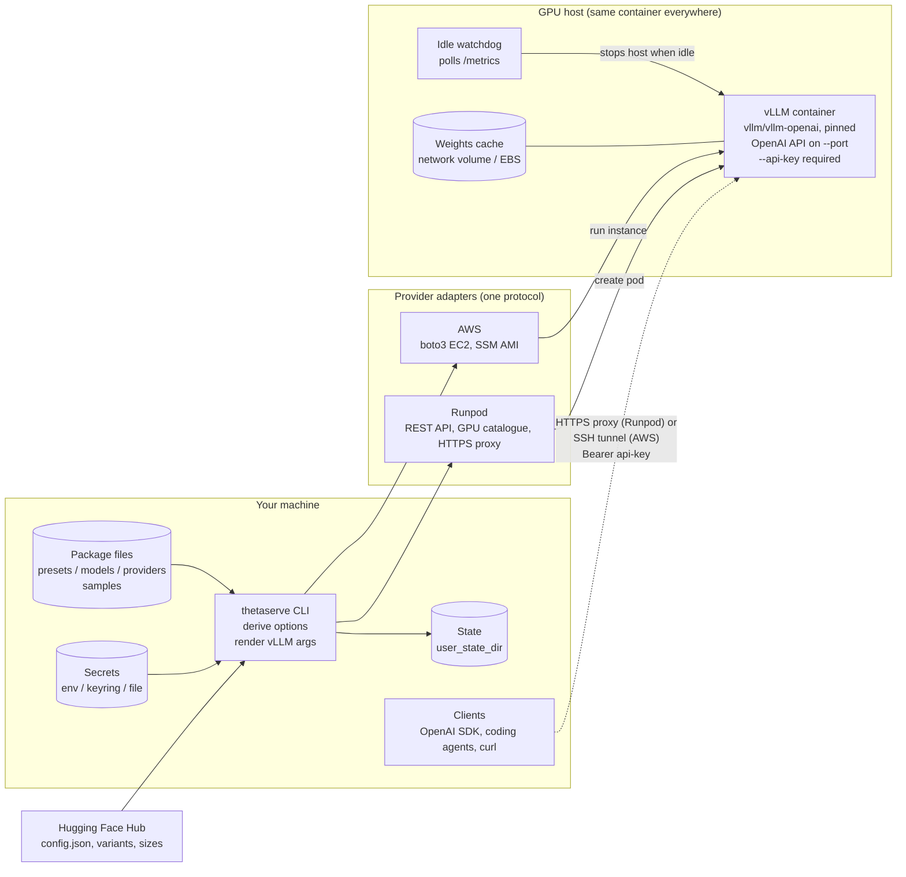
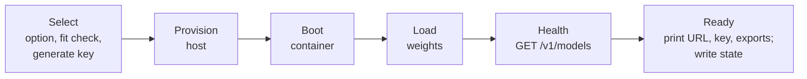

# thetaserve: design brief v0.3

Status: beta. v0.1.0 is on PyPI (M5, 2026-10-23). M4 runs are pending. Date: 2026-10-22,
status updated 2026-10-27. This version merges the decision records of 2026-10-20 to
2026-10-22 (section 17), and decision D4. It replaces v0.2 of 2026-10-20 and the v0.1 draft
(PDF, not kept in the repository).

Writing rules for this document: dates are ISO 8601. Memory sizes are GiB (IEC 80000-13)
unless a provider quotes GB. Text follows ASD-STE100 where it applies.

## 1. What it is

thetaserve is an open-source CLI, published on PyPI. It launches an open-weight model on a
rented GPU and gives you a secured, OpenAI-compatible endpoint.

You name a **model** and a **use case**. thetaserve reads the model's metadata from Hugging
Face and the GPU prices and stock from the **provider**. It then shows the launch **options**
that fit, and you select one. `--device` limits the options to one GPU.

Initial models: Qwen3.8-27B and Gemma 4 31B (both dense, Apache 2.0). Initial provider:
Runpod (core). AWS (extra) comes after v0.1 (section 12). Engine: vLLM only.

Non-goals for v0.1:
- Multi-user production serving, autoscaling or load balancing.
- Fine-tuning or training.
- Other engines and providers (see section 16).

## 2. Decisions (final for v0.1 release)

| Topic | Decision |
| --- | --- |
| Provider layer | Custom adapters behind one `Provider` protocol. Runpod in core, AWS as the `aws` extra. SkyPilot is NOT a dependency. A SkyPilot adapter can come later as an optional `skypilot` extra |
| Launch settings | Derived from live model and GPU data, not from hand-written profiles (section 6, decisions D1, D2 and D4) |
| Weight sources | Variants come from trusted publishers only, pinned to one commit (section 5.3, decision D3) |
| Language and tooling | Python 3.13+, uv, hatchling build backend |
| Platforms | Linux, macOS and Windows, including headless Linux (SSH, WSL, containers, CI). CI runs tests on all three |
| Libraries | typer + rich (CLI), pydantic v2 (config models), pyyaml, httpx (Runpod, Hugging Face, health checks), keyring (OS secret store), platformdirs (per-OS config and state paths) |
| Extras | `aws` → boto3. Dev tools (pytest, respx, moto, ruff, mypy) are a `dev` dependency group, not a published extra. Add each dependency in the milestone that first uses it |
| License | Apache-2.0 |
| Release | GitHub Actions + PyPI trusted publishing (no stored tokens). Claim the `thetaserve` name on PyPI early |
| Runtime | Official `vllm/vllm-openai` image, one pinned version for all launches |
| Access | Runpod: provider HTTPS proxy URL + per-launch API key. AWS: SSH tunnel, no public model port |
| Not used | Terraform, Knative/KServe (KServe only for a later shared team gateway) |

## 3. Packaging

```
uv tool install thetaserve              # core + Runpod
uv tool install "thetaserve[aws]"       # + AWS (boto3), after v0.1
```

`pip install thetaserve` also works. Entry point: `thetaserve = "thetaserve.cli:app"`.

The built-in YAML files (section 5) ship inside the package as package data. Users override or
extend them with files of the same name in the user config directory
(`platformdirs.user_config_dir("thetaserve")`, for example `~/.config/thetaserve/` on Linux).
A user file's top-level keys replace built-in keys with the same name, whole.

## 4. Components

There is no always-on control plane. The CLI on your machine calls the provider API directly.
It launches one GPU host that runs the vLLM container, waits until the model answers, and
records the deployment in local state. Solid arrows are control calls. Dotted arrows are
inference traffic.



| Component | Responsibility |
| --- | --- |
| CLI (`cli.py`) | Commands, progress output, error messages |
| Config (`config.py`) | Pydantic models for the package YAML files. Load and merge built-in and user files. Validation errors give the file and the key |
| Options (`options.py`) | Read model facts and weight variants from Hugging Face. Find the cheapest GPU in stock for each precision. Select the recommended option (section 6.1) |
| Spec (`spec.py`) | `LaunchSpec` (image, vLLM args, env, port, disk), memory estimate and the `vllm serve` command |
| Providers (`providers/`) | `base.py` protocol and dataclasses, `runpod.py`, `aws.py` |
| Host files | `guard.py` (key middleware) and `watchdog.py` (idle and lifetime stop), standard library only. `LaunchSpec.script()` writes both to the host, starts the watchdog and execs vLLM. `aws_user_data.sh` template (M6, AWS) |
| Health (`health.py`) | Poll `/v1/models`. Read the KV-cache size that vLLM logs at start-up. Report the real maximum context |
| State (`state.py`) | `state.json` in `platformdirs.user_state_dir("thetaserve")` (mode 600 on POSIX): deployments, endpoints, start time, rate. No secrets |
| Secrets (`secrets.py`) | Make a new vLLM key for each launch. Lookup order, first hit wins: (1) environment variable (`RUNPOD_API_KEY`, `HF_TOKEN`, ...); (2) keyring, only if a real backend is available (the `fail` and `null` backends count as unavailable); (3) `secrets.json` in the user config directory, mode 600 on POSIX, with a one-time warning that it is plaintext. Writes go to keyring when available, else to the file |
| Bench (`bench.py`) | Benchmark harness (section 10) |

## 5. Configuration

All files ship in `src/thetaserve/catalog/`. Users override them as section 3 describes.

### 5.1 presets.yaml

A use case sets the requirements for a launch. Presets are the only opinionated table.

```yaml
coding:   { min_context: 131072, tools: true,  min_bits: 8 }
chat:     { min_context: 32768,  tools: false, min_bits: 4 }
research: { min_context: null,   tools: true,  min_bits: 8 }   # null: the model's maximum
```

- `min_context`: the context length of every option, in tokens.
- `tools`: warn when no tool-call parser is known for the model.
- `min_bits`: the precision floor. It selects the recommended option. It does not hide options.

The floors are judgements, not measurements. Coding and research run long chains of tool
calls, and one wrong token breaks a step. Chat does not. The floors stay until `bench`'s
coding-quality check (section 10) compares 4-bit with 8-bit for a model family. Where 4-bit
gives the same quality, that family's floor goes down. Reasoning is not a preset setting: the
client switches thinking on or off for each request.

### 5.2 bandwidth.yaml

GPU memory bandwidth in GB/s from vendor data sheets, keyed by Runpod GPU ID. Used only for
the `tok/s` estimate (section 6.1). A MIG slice gets its parent's bandwidth in proportion to
its memory.

### 5.3 Weight sources

`up` reads weight variants from the Hugging Face Hub (section 6.1). Anyone can publish a
repository with the tag `base_model:quantized:<repo>`, and download counts are easy to inflate.

What a variant can and cannot do (checked 2026-10-22):

- `.safetensors` files hold only tensors. Loading them runs no code. Model-supplied Python runs
  only with `--trust-remote-code`, and thetaserve never passes it.
- A publisher can change the weights before quantising. No metadata shows a backdoor or
  removed safety training.
- `chat_template.jinja` and `tokenizer_config.json` shape every prompt and tool call. vLLM
  renders them in a sandbox, but a changed template can still change behaviour, for example by
  adding a system prompt.
- vLLM downloads `main` at start-up. A push after the user selects an option changes what runs.

Rules:

1. **Pinned commit (implemented).** When `up` reads a variant's file sizes, it records the
   commit hash of that revision. It passes `--revision <hash>` to `vllm serve`. vLLM uses the
   model revision for the tokenizer too, so the tokenizer and chat template are pinned as well.
2. **Trusted publishers (implemented, D3).** `up` uses only variants from the base model's own
   organisation or from an organisation in a packaged `publishers.yaml`: initially `RedHatAI`
   (Red Hat's verified organisation, maintainers of vLLM's `llm-compressor`) and `nvidia`.
   Users add organisations in their config directory.
3. **Opt-in for the rest (implemented, D3).** `--any-publisher` also lists variants from other
   publishers, marked in the table.

A trusted publisher can still publish bad weights. These rules limit whom the user trusts.
They do not verify the weights. A check of the weights against the base model needs a GPU and
a test set, so it is a possible `bench` feature, not a launch check.

### 5.4 Family settings

Some vLLM flags do not come from metadata: the tool-call and reasoning parsers, and settings
such as disabling image input. Today they come from `common_args` of the `models.yaml` entry
whose `hf_family` is the base repository. A model with no entry launches without extra flags,
with a warning.

Planned (D1): a small packaged file keyed by `architectures[0]` from `config.json` (for example
`Qwen3_8ForCausalLM`), so that all repositories of a family get the flags. Add it when a second
model of a known family is needed.

### 5.5 models.yaml

`vllm_image` pins the image for all launches. Each entry gives a short model name for
`--model`, its base repository and the family flags (section 5.4):

```yaml
schema_version: 2
vllm_image: vllm/vllm-openai:v0.32.0   # M1 pilot, 2026-10-22
qwen3.8-27b:
  hf_family: Qwen/Qwen3.8-27B
  common_args: [--enable-prefix-caching, --reasoning-parser, qwen3,
                --enable-auto-tool-choice, --tool-call-parser, qwen3_xml,
                --max-num-seqs, '32']   # M1 pilot, 2026-10-22: A40, FP8 weights
gemma4-31b:
  hf_family: google/gemma-4-31B-it   # instruction-tuned; quantisations are made from this
  common_args: [--enable-prefix-caching, --reasoning-parser, gemma4,
                --enable-auto-tool-choice, --tool-call-parser, gemma4,
                --limit-mm-per-prompt, '{"image": 0, "video": 0, "audio": 0}',
                --max-num-seqs, '32']   # M2 pilot, 2026-10-22: RTX 6000 Ada, FP8 weights
  kv_scale: 1.5   # M2 pilot: ~120 KiB per token in three runs; config.json gives 80
```

`up` refuses to launch an image that contains `TODO`. Flags marked `VERIFY` have not run on
hardware. Qwen3.8-27B needs `--max-num-seqs`: vLLM's default of 256 requests is more than the
Mamba cache blocks of its linear-attention layers (187 on an A40 at 128K), and vLLM stops at
start-up. Gemma 4 launches text-only: with image, video and audio input on, vLLM reserves
memory for the encoders, and 128K did not fit on a 48 GB card (M2 pilot). `kv_scale` multiplies
the KV cache per token from `config.json` by a measured factor (default 1). Qwen3.8-27B measured
1.04, Gemma 4 31B 1.5 (section 13.2).

### 5.6 samples.json

A dated snapshot of the live data that section 6.1 reads:

- `runpod`: Runpod `GET /v2/catalog/gpus` for each cloud tier (`SECURE`, `COMMUNITY`), because
  the stock is different for each tier; NVIDIA GPUs and the fields `up` reads only;
- `huggingface`: for each `models.yaml` entry, the model facts and weight variants (with commit
  hashes) that `up` calculated from the Hub.

A dry run without a Runpod key uses it instead of the network, and says so. A model that is
not in the snapshot is read from the Hub. Launches never use the snapshot.
`just samples` fetches it again; this needs the Runpod key. Do it when the snapshot is more
than a few months old, or when `models.yaml` gets a new model.

### 5.7 providers.yaml

```yaml
runpod:
  api_key_env: RUNPOD_API_KEY      # else keyring entry "thetaserve/runpod", else secrets file
  cloud_type: SECURE               # or COMMUNITY
  network_volume: thetaserve-cache # created on first use, per data centre; null = no cache
  network_volume_gb: 100
  container_disk_gb: 40
aws:
  profile: thetaserve              # dedicated IAM user, minimal EC2 policy
  region: us-east-1
  ami_ssm: /aws/service/deeplearning/ami/x86_64/base-oss-nvidia-driver-gpu-ubuntu-22.04/latest/ami-id
  root_volume_gb: 200
  ssh_key_name: thetaserve
  allow_cidr: auto                 # caller's public IP /32
```

## 6. Launch rules

### 6.1 Options

1. **Input.** A model (a Hugging Face repository, or a `models.yaml` key), a use case
   (`--use`, default `coding`), and optional pins: `--device` (a Runpod GPU ID such as
   `NVIDIA A40`), `--context`, `--kv-cache-dtype`, `--min-precision`.
2. **Model facts.** Read `config.json` from the Hub:

   | Fact | Source | Example (Qwen/Qwen3.8-27B) |
   | --- | --- | --- |
   | KV bytes per token | `layer_types`, `num_key_value_heads`, `head_dim` | 16 full-attention layers of 64, 4 KV heads, head dim 256 → 64 KiB at BF16 |
   | Maximum context | `max_position_embeddings` | 262144 |

   Count only full-attention layers per token. Sliding-window layers add a fixed amount.
3. **Weight variants.** The base repository plus the 40 most downloaded repositories with the
   tag `base_model:quantized:<repo>`. Keep only formats vLLM serves (BF16/FP16, `fp8`, `awq`,
   `gptq`, `compressed-tensors`, `modelopt`, `mxfp4`). Drop GGUF and MLX. The weight size is the
   sum of the top-level `.safetensors` files at the current commit; copies in subfolders (gpt-oss
   has `original/`) are not loaded. `mxfp4` (gpt-oss) is offered on every architecture: vLLM
   runs it on Ampere with Marlin kernels (gpt-oss-120b ran on an A100 80GB, 2026-10-29). On Ada it
   is unverified. The Hugging Face token from `setup` opens
   gated repositories.
4. **GPUs.** Read VRAM, price and per-data-centre stock from Runpod
   `GET /v2/catalog/gpus?include=AVAILABILITY&product=POD`. Read the architecture from the pool
   name (`AMPERE_48` → ampere). Skip GPUs whose pool does not map to an architecture. NVIDIA
   only. With `--device`, keep only that GPU, and stop with an error if it is unknown or sold
   out.
5. **Fit.** weights + KV per token × `kv_scale` × context + fixed KV + overhead (3.2 GiB)
   ≤ VRAM × `gpu_memory_utilization` (0.92). Do not use FP8 KV cache on Ampere. Use FP4
   weights only on Blackwell.
6. **Rows.** For each weight precision (16, 8, 4 bits, as available) and each KV-cache
   precision (16-bit, FP8), show the cheapest GPU in stock that fits. Within a precision, use
   the first variant that fits, in download order, base repository first. Leave out a
   combination that fits no GPU in stock. Sort the rows by price. On the same price, put higher
   weight precision first, then BF16 KV before FP8 KV.
7. **Recommended row.** The cheapest row that meets the preset's `min_bits`, or the cheapest
   row if none does. The prompt defaults to it. `--yes` and `--dry-run` take it.
   `--min-precision` removes lower precisions from the table.
8. **Speed estimate.** `tok/s` = 0.6 × memory bandwidth ÷ weight size, for one request at short
   context. Rows below 8 bits use the size of the smallest 8-bit variant, because unpacking
   4-bit weights costs about as much time as the smaller read saves. For a mixture-of-experts
   model, the size is the weights outside the routed experts (attention, embeddings, dense and
   shared MLP layers, from `config.json`, at BF16) plus the active share of the rest
   (`num_experts_per_tok` ÷ the number of experts). gpt-oss-120b on an A100 80GB PCIe: estimate
   189, measured 165 tok/s (2026-10-29). `?` when the bandwidth is
   not known. The 0.6 factor is a guess until `bench` measures it.
9. **Render.** `vllm serve <repo> --revision <hash> --port <port> --api-key $VLLM_API_KEY
   --max-model-len N --kv-cache-dtype D --gpu-memory-utilization 0.92 <family args> <extra args>`.

Planned, not implemented:
- Put data centres that already hold the cache volume first, so the weights are not downloaded
  again. Today the Runpod adapter selects the data centre when it creates the pod (section 8.1).
- `--repo` to pin a variant.
- Calibrate the overhead from `bench` results. Each result records the estimated and the
  measured KV capacity.

### 6.2 Memory constants

Per sequence, for the two launch models:

| Model | KV per token (BF16) | Fixed KV | 128K KV BF16 / FP8, fixed KV included |
| --- | --- | --- | --- |
| Qwen3.8-27B | 64 KiB (16 of 64 layers full attention, 4 KV heads, head dim 256) | small linear-attention state | 8.0 / 4.0 GiB |
| Gemma 4 31B | 80 KiB (10 global layers, 4 KV heads, head dim 512); vLLM needs ~120 KiB (`kv_scale` 1.5) | ~0.8 GiB (50 sliding-window layers, window 1024) | 15.8 / 7.9 GiB |

Ampere and Ada: the A6000 and A40 (Ampere) have no native FP8. vLLM runs FP8 weights with
weight-only kernels. Block-quantised FP8 (`RedHatAI/...-FP8-block`) also runs weight-only on Ada
(RTX 6000 Ada, M2 pilot). Token generation speed is almost the same as on Ada cards, because memory
bandwidth limits it. Prefill of a long prompt is approximately 2-3× slower. Prefix caching
hides most of this for coding agents, because their prompts repeat between steps.

## 7. CLI

```
thetaserve setup                       # check and collect provider credentials, HF token, SSH key
thetaserve up --provider runpod --model qwen3.8-27b [--use coding] [--min-precision 8bit]
             [--device "NVIDIA A40"] [--port 8000] [--context N] [--kv-cache-dtype D]
             [--idle 30m] [--max-life 10h] [--name dev] [--dry-run] [--yes]
thetaserve status [name]               # endpoint, model, uptime, cost so far, idle time
thetaserve env [name]                  # OPENAI_BASE_URL / OPENAI_API_KEY exports
thetaserve tunnel [name]               # AWS only
thetaserve logs [name] [-f]
thetaserve stop | start | down [name] [--purge]
thetaserve list models|providers
thetaserve bench --provider ... --device ... --model ... [--out results/]
```

`--dry-run` prints the launch spec, the vLLM command and the provider request body, with
secrets masked. It creates nothing. Without a Runpod key it uses the samples (section 5.6),
because the live Runpod catalogue refuses requests without a key (`401`). Thus a dry run for a
built-in model needs no credentials and no network access.

`up` lifecycle:



Before it provisions a host, `up` shows the hourly rate. It shows progress. If a step stalls,
it stops early with a clear message. Expected time: 5-15 min on the first start (image pull
and approximately 30 GiB of weights), 2-5 min on a warm restart from the cache volume.

## 8. Providers

```python
class Provider(Protocol):
    name: str

    def plan(
        self, spec: LaunchSpec
    ) -> dict[str, Any]: ...  # request body, secrets masked; no network
    def create(self, spec: LaunchSpec, secrets: Mapping[str, str]) -> Deployment: ...
    def wait_running(self, d: Deployment, timeout_s: int) -> Deployment: ...
    def refresh(self, d: Deployment) -> Deployment: ...  # current status and cost
    def endpoint(self, d: Deployment) -> Endpoint: ...  # base_url, needs_tunnel
    def logs(self, d: Deployment, follow: bool, tail: int = 100) -> Iterator[str]: ...
    def stop(self, d: Deployment) -> Deployment: ...
    def start(self, d: Deployment) -> Deployment: ...
    def destroy(self, d: Deployment, purge: bool = False) -> None: ...
    def price_per_hour(self, spec: LaunchSpec) -> float | None: ...
```

`create` gets the secrets as a separate argument, so `LaunchSpec` and the state file never
hold them. `up` stores the per-launch vLLM key in the secrets store as
`deployment/<name>/api-key` before it creates the host. `down` deletes the key.

### 8.1 Runpod (core)

- API: Runpod REST API v2, `https://api.runpod.io/v2`, Bearer authentication. The spec is at
  `https://api.runpod.io/v2/openapi.json`. v1 (`rest.runpod.io/v1`) is legacy. Checked
  2026-10-20. Check the spec again before you change the adapter.
- Calls: `POST /v2/pods` (create), `GET /v2/pods/{id}` (status, `cost` in USD/h),
  `POST /v2/pods/{id}/action` with `start` or `stop` (`409` if not valid for the current
  status), `DELETE /v2/pods/{id}`, `GET /v2/pods/{id}/logs` (Server-Sent Events,
  `data: {"line": ...}`), `GET|POST /v2/network-volumes`,
  `GET /v2/catalog/gpus?include=AVAILABILITY&product=POD` (all GPUs, for options) and
  `GET /v2/catalog/gpus/{id}?include=AVAILABILITY&product=POD` (price and per-data-centre stock
  of one GPU). On `429`, wait for `Retry-After` and try again.
- Create body: `gpu {id, count, minCudaVersion}`, `image`, `entrypoint ["/bin/bash","-c"]` and
  `cmd ["exec vllm serve ..."]`, so that `$VLLM_API_KEY` expands from the pod's environment;
  `env`, `ports ["<port>/http"]`, `disk`, `cloud`, `mounts.network [{volumeId, path}]`,
  `dataCenterIds [<volume's data centre>]`. Create does not search for capacity and does not
  try another GPU.
- Endpoint: `https://<podId>-<port>.proxy.runpod.net/v1`. The proxy runs through Cloudflare
  with a 100 s timeout (`524`). Clients must stream long generations.
- Weights cache: a network volume mounted at `/runpod-volume`, with `HF_HOME` and vLLM's
  compile cache (`VLLM_CACHE_ROOT`) on it. A volume
  is in one data centre, so the pod must run there. On first use, `up` creates the volume in the
  data centre with the most stock of the GPU. If the GPU is sold out in every data centre that
  has a volume, `up` stops with an error. Planned: offer a volume in another data centre.
  `network_volume: null` removes the volume, the mount
  and the data-centre pin.
- Resume: when a stopped pod restarts, the same GPU type can be unavailable. `start` then stops
  with Runpod's message. Planned: offer a new pod on the same volume.
- Idle stop: the pod must stop itself. If vLLM exits, Runpod restarts the container, so an exit
  is not sufficient. Runpod puts `RUNPOD_POD_ID` and a pod-scoped `RUNPOD_API_KEY` in every pod,
  also when the create body sets `env`. With them the watchdog calls
  `POST /v2/pods/$RUNPOD_POD_ID/action {"action": "stop"}`. M3 probe, 2026-10-22: an RTX 3090
  pod running only that call went from RUNNING to EXITED. M3 pilot, 2026-10-23: a Qwen3.8-27B
  pod launched with `--idle 5m` stopped itself after it was left idle (user report; the pod was
  removed before its log was read).
- Cloud tier: the pod's `cloud` is `SECURE` (Runpod data centres) or `COMMUNITY` (community
  hardware). It selects the price and stock that Runpod gives for that tier
  (`GET /v2/catalog/gpus?cloud=...`). Set it in `providers.yaml` (`cloud_type`), or for one
  launch with `--cloud`. Both tiers use the same `/v2/pods` lifecycle above.
- Community Cloud pods cannot mount a network volume (Runpod network-volume documentation,
  checked 2026-10-25). On `COMMUNITY`, `up` ignores `network_volume`, tells you, and launches
  without a weights cache and without a data-centre pin, as with `network_volume: null`.
- CUDA floor: `vllm/vllm-openai:v0.32.0` is built on CUDA 13.0 and turns off forward
  compatibility. A host whose driver supports only CUDA 12.x fails at start. The create body
  sends `gpu.minCudaVersion: "13.0"`, and the stock lookups send `minCudaVersion=13.0`, so the
  options show only hosts that can run the image. Smoke test, 2026-10-28: a Community Cloud RTX
  A5000 with a CUDA 12.4 driver failed with "The NVIDIA driver on your system is too old". On
  that day, all Secure Cloud hosts had CUDA 13.x, and most Community Cloud stock had 12.x.
  The floor is in the adapter (`MIN_CUDA`); change it together with `vllm_image`.

### 8.2 AWS (`aws` extra)

- AMI from the public SSM parameter in `providers.yaml`.
- RunInstances with the device's instance type, gp3 root volume,
  `InstanceInitiatedShutdownBehavior=stop`, and user data that installs a systemd unit. The
  unit runs the vLLM container and the watchdog.
- v0.1 uses one instance type. The GPU-to-instance-type map (for example L40S → `g6e.xlarge`)
  moves to the `aws` section of `providers.yaml`. Derive it from EC2 `DescribeInstanceTypes`
  when more instance types are supported.
- Security group: SSH (22) from the caller's /32 only. `thetaserve tunnel` runs
  `ssh -N -L PORT:localhost:PORT`.
- Idle stop: the watchdog runs `shutdown -h now`. The disk stays.
- `setup` finds and explains the prerequisites: credentials, GPU quota (G and VT instances),
  key pair.
- Later option: SSH through AWS Systems Manager, so that no port is open.

Why the access models are different: Runpod already puts HTTPS in front of each pod port, so an
API key is sufficient. On AWS, an open port needs TLS and certificate management. An SSH tunnel
gives encryption and IP restriction at no cost, and the instance stays invisible to the
internet.

## 9. Security

- A new 32-byte API key for each launch. The secrets store (section 4) holds it, never the
  state file or the logs. All output masks it.
- Secrets reach the host only as environment variables of the server process.
- vLLM's `--api-key` protects only `/v1` and a few other prefixes. `/metrics`, `/load`,
  `/version` and others stay open (M1 pilot: `/metrics` gave 200 without the key), and vLLM has
  no option to turn them off. The launch script writes `guard.py` to the host and passes it to
  `vllm serve --middleware`. It requires the key on every path except `/health`. The watchdog
  (section 15) runs on the host with the key, so it can still read `/metrics`.
- The key is hex, not base64url. A key that starts with `-` makes `vllm serve` read it as an
  option (M1 pilot).
- Weights: section 5.3.
- AWS: a dedicated IAM user with a minimal policy: EC2 run, describe, stop and terminate,
  security groups, key pairs, and the SSM AMI parameter.
- Client data: rented hardware processes the prompts. For client work that needs stronger
  guarantees, use Runpod Secure Cloud or AWS, not Community Cloud.

## 10. Benchmark harness (`thetaserve bench`)

`bench --device` launches the recommended option on that GPU (section 6.1), or with
`--precision` the first option at exactly that weight precision. It runs a fixed
workload on the endpoint and writes one JSON result. Then it removes the deployment, unless
`--keep`. It removes the deployment also when the run fails.

It measures, timed on the caller's machine (proxy latency included):
- tokens per second at 1 and 4 concurrent requests, 256 output tokens each (`ignore_eos`),
  3 rounds, median: per request and in total;
- time to first token at 8K, 32K and 128K prompt lengths (not more than the context). Each prompt
  starts with a new random prefix, so the prefix cache does not hide the prefill;
- memory from vLLM's start-up log (weights, peak activation, CUDA graphs, KV cache size and
  tokens), next to the estimate (section 6.1) and `kv_scale`;
- time to ready, and the weight download time from the log;
- $/h and $ per million output tokens at 1 and 4 requests;
- tool-call reliability: 10 fixed prompts against 5 coding-agent tools, 5 times each at
  temperature 0.7 (50 calls), passed when the call has the exact function and arguments. It compares 4-bit with 8-bit (section 5.1).

Tool calls replace the planned coding-quality check. Malformed tool calls are the known failure
of 4-bit weights for agents (section 5.1), and a code check would run model output on the
caller's machine.

Result file: `results/<model>/<device>-<weights>-<provider>-<date>.json`. It records the configuration
hash (image, repository, vLLM arguments, GPU, cloud type), thetaserve and vLLM versions, image
digest, cloud type, data centre, price and all metrics. A second run of the same model and GPU on
the same day replaces the file. Commit the results, so that anyone can reproduce and compare
them.

Runs use no cache volume, whatever `network_volume` says, so the pod can go to any data
centre with the GPU (not every data centre supports volumes). The weights go on the container
disk, sized to 1.3 × the weights + 10 GB. A warm restart is not measured: without a volume, a
stopped pod loses its container disk.

The M4 runs and metrics: [benchmark plan](reference/benchmark-plan.md). They use Runpod Secure Cloud, the default `cloud_type`, so that the results show what a
user gets by default.

## 11. Repository layout

```
thetaserve/
  pyproject.toml  uv.lock  justfile  README.md  LICENSE  CHANGELOG.md  AGENTS.md
  src/thetaserve/
    __init__.py  cli.py  config.py  options.py  spec.py  state.py  secrets.py  health.py
    providers/  base.py  runpod.py  aws.py (M6)
    guard.py  watchdog.py      (written to the host by the launch script)
    remote/     aws_user_data.sh   (M6)
    catalog/    presets.yaml  bandwidth.yaml  models.yaml  providers.yaml  publishers.yaml
                samples.json
  results/      (M4)
  tests/        test_config.py  test_options.py  test_spec.py  test_runpod.py  test_cli_lifecycle.py ...
  docs/         DESIGN.md  tutorials/  how-to/  reference/  explanation/
  .github/workflows/  ci.yml  release.yml (M5)
```

## 12. Build order

| Milestone | Scope | Done when |
| --- | --- | --- |
| M0 (done) | Scaffold, pyproject with extras, config models, catalogues, resolver, fit check, `list`, `up --dry-run`, tests, CI | `thetaserve up ... --dry-run` prints a vLLM command |
| M1 (done 2026-10-22) | Runpod adapter, secrets, state, health, `up/status/env/logs/stop/down`; options from live data (D1, D2, D4); pinned revision (D3) | Qwen3.8-27B runs on a Runpod 48 GB GPU and a coding agent connects |
| M2 (done 2026-10-22) | Pilot: verify family settings and calibrate the overhead for both launch models; resolve the open questions in section 13 | Both launch models have verified family flags and a measured overhead |
| M3 (done 2026-10-23) | Watchdog (idle and maximum lifetime) on Runpod | An idle pod stops itself |
| M4 (harness done; runs pending) | `bench` and first results | Results for 2 models × 3 GPUs committed; published post (target 2026-11-09) |
| M5 (done 2026-10-23, moved ahead of M4) | v0.1.0 beta release on PyPI, Runpod only | `uv tool install thetaserve` works on a clean machine |
| M6 (after v0.1) | AWS adapter and tunnel | Same model on g6e.xlarge through a tunnel |

M5 moved ahead of M4 on 2026-10-23: launch, watchdog and teardown on Runpod already work
(M1-M3), so v0.1.0 ships as a beta and the `bench` results follow in a later release.

AWS moved after v0.1 on 2026-10-23: the AWS account has no GPU quota yet (request
rejected), and an adapter that cannot be run on real hardware is not released.

## 13. Open questions (resolve in M1/M2)

- ~~Runpod REST API fields, proxy URL format, request timeout on the proxy.~~ Resolved in M1
  (section 8.1). A streamed response of 299 s passed the proxy without a cut.
- ~~Runpod pod self-stop credential.~~ Resolved in M3: the pod's own `RUNPOD_API_KEY` (section 8.1).
- Quality of the FP8 and 4-bit variants for both models.
- ~~vLLM version that serves both models; flags to disable image input; Gemma tool parser.~~
  Resolved in M2: v0.32.0 serves both. `--limit-mm-per-prompt` with every modality at 0 runs
  Gemma text-only. The `gemma4` tool and reasoning parsers work (section 13.2).
- FP8 KV cache on Ampere in the pinned vLLM. On Ada it works (M2 pilot).
- ~~Does `--api-key` protect `/metrics`?~~ No; thetaserve's guard does (section 9). Confirmed on
  2026-10-22: `/metrics`, `/load`, `/version` and `/v1/models` give 401 without the key, `/health` 200.
- Does either model need a Hugging Face token? `Qwen/Qwen3.8-27B-FP8` and
  `RedHatAI/gemma-4-31B-it-FP8-block` downloaded without one. Other variants not checked.
- IOPS cost of Runpod global volumes (beta). Cold start without a cache volume: 3 min 52 s
  from pod creation to ready (M1 pilot).
- The `tok/s` factor (section 6.1, point 8): the A40 decoded 20.2 tok/s against an estimate of
  14, approximately 0.85 of bandwidth. One measurement; keep 0.6 until `bench`.
- ~~D3: accept or change the trusted-publisher rules.~~ Accepted 2026-10-22 (section 5.3).

### 13.1 M1 pilot record (2026-10-22)

Qwen/Qwen3.8-27B-FP8 at revision `017b9c7a`, 128K context, BF16 KV cache, on one Runpod Secure
A40 (48 GB, EU-SE-1, $0.59/h), vLLM v0.32.0, `--max-num-seqs 32`, no cache volume.

| Measure | Estimate | Measured |
| --- | --- | --- |
| Weights | 28.7 GiB | 28.81 GiB |
| Overhead | 2 GiB | 1.98 GiB peak activation + 0.26 GiB CUDA graphs |
| KV cache | | 9.88 GiB, 155,177 tokens |
| Decode, one request | ~14 tok/s | 20.2 tok/s |
| Pod creation to ready | | 3 min 52 s (weights 37 s, engine start 145 s) |

Checks that passed: `/v1/models` with the key (401 without), a tool call through `qwen3_xml`
with reasoning separated, a 299 s stream through the proxy. `/metrics` answered without the key;
the guard of section 9 came after this run, and a second launch the same day confirmed it. On
that launch the pi coding agent wrote a Python script: 3 requests with tool calls, all 200,
prefix-cache hit rate 59 %.
Two launches before this one failed: vLLM's default `--max-num-seqs` (section 5.5), and an API
key with a leading `-` (section 9). `up` now stops when the vLLM log shows an error, instead of
waiting the full 40 minutes.

### 13.2 M2 pilot record (2026-10-22)

RedHatAI/gemma-4-31B-it-FP8-block at revision `d7242548`, 96K context, FP8 KV cache, on one
Runpod Secure RTX 6000 Ada (48 GB, $0.99/h), vLLM v0.32.0, text-only, `--max-num-seqs 32`, no
cache volume.

| Measure | Estimate | Measured |
| --- | --- | --- |
| Weights | 31.0 GiB | 31.07 GiB |
| Overhead | 2 GiB | 2.84 GiB peak activation + 0.08 GiB CUDA graphs + 0.22 GiB non-torch = 3.14 GiB |
| KV cache | | 9.46 GiB, 162,789 tokens: ~61 KiB per token at FP8, ~122 KiB at BF16 |
| Decode, one request | ~16 tok/s | 23.1 tok/s, request latency included |
| vLLM start to ready | | 4 min 5 s (weights download 103 s, compile and warm-up 96 s) |

Checks that passed: `/metrics` and `/v1/models` give 401 without the key, `/health` 200; a tool
call through `gemma4`; reasoning separated through `gemma4`; the pi coding agent worked with
the endpoint.

Three launches before this one failed at start-up, each with too little KV cache memory for
one full sequence:

| GPU (48 GB), KV cache | Context | Flags | KV vLLM needed | Free for KV |
| --- | --- | --- | --- | --- |
| Probably L40, FP8 (row not recorded) | 131,072 | image input on, `--max-num-seqs` 256 | 7.3 GiB | 6.81 GiB |
| Not recorded | not recorded | not recorded | not recorded | not recorded |
| Not recorded, BF16 | 102,400 | text-only, 32 | 11.73 GiB | 7.25 GiB |

The first and third, and the successful run, give approximately 120 KiB per token at BF16,
against 80 KiB from `config.json` (1.5×). The
cause is not known; `kv_scale` records the factor until it is. With image input on, weights and
overhead used 37.4 GiB; text-only, 34.2 GiB. The second crash lost its log; `up` now saves the
log of a crash to the state directory.

Calibration from both pilots: overhead 3.2 GiB for all models (the larger measurement);
`kv_scale` 1.5 for Gemma 4 31B, 1 for Qwen3.8-27B (measured 1.04). Recheck in `bench` (M4).

## 14. Rules for contributors (and agents)

- Tests never call real provider APIs or the Hugging Face Hub. Mock them with respx (httpx)
  and moto (boto3).
- Never print or log a secret. Keep secrets only in keyring or the mode-600 secrets file,
  never in the state file.
- No hard-coded POSIX paths. Get config and state locations from platformdirs.
- Every hand-written number (overhead, family flags) comes from a recorded run.
  Mark an unmeasured value `TODO`. Sizes computed from metadata need no measurement.
- Keep core dependencies to the list in section 2.

## 15. Cost controls

| Control | How it works |
| --- | --- |
| Idle shutdown | Every minute, the watchdog reads vLLM's Prometheus `/metrics`. If the completed-request counter does not change and no request runs for `--idle` (default 30 min), the watchdog stops the host (sections 8.1, 8.2) |
| Maximum lifetime | Hard stop after `--max-life` (default 10 h), regardless of activity |
| Stop and down | `stop` pauses compute. With a cache volume, the weights stay on it, and you pay for the volume only. Without one, a stopped pod bills nothing, and it loses the weights. `down` removes compute. The cache volume stays, unless `--purge` |
| Visibility | `up` shows the hourly rate before it creates anything. `status` shows the rate, uptime and cost so far |
| Budget alarm | Recommended, set once by hand: an AWS Budgets alert and a Runpod spend limit |

Indicative Runpod Secure Cloud prices (seen 2026-10; the CLI reads live prices):

| Device | $/h | 2 h/day × 30 days | 8 h/day × 22 days |
| --- | --- | --- | --- |
| A40 48 GB | 0.59 | $35 | $104 |
| RTX A6000 48 GB | 0.59 | $35 | $104 |
| RTX 6000 Ada 48 GB | 0.99 | $59 | $174 |
| L40S 48 GB | 1.09 | $65 | $192 |

## 16. Roadmap after v0.1

| Phase | Scope | Done when |
| --- | --- | --- |
| Next | More providers (Vast.ai), engines (SGLang, Ollama for CPU and Mac), several models on one host | A flag selects the provider and the engine |
| Later | Shared team endpoint: gateway with per-user keys and usage metering (KServe candidate, section 2) | ThetaPlex products and client pilots use a shared inference service |

## 17. Decision log

Each entry keeps the context and the alternatives of a decision. The rules themselves are in
the sections named. Add a new entry to change a decision; do not edit an accepted entry.

### D1. Derive launch options from live model and GPU data

Date: 2026-10-20. Status: accepted. Rules: sections 5.1, 5.4, 6.1, 8.2. Point 6 changed by D2.

Context. v0.2 selected a launch from two hand-written files. `devices.yaml` listed GPUs.
`models.yaml` listed each model's settings per memory tier (24g, 48g, 80g). The first real-run
preparation on 2026-10-20 showed three problems:

- The files go stale. The RTX A6000 named in M1 was sold out on both Runpod clouds. The A40 had
  the same price ($0.59/h Secure) and high stock, but thetaserve did not show it, because
  `devices.yaml` did not list it.
- Tiers are artificial. They tie three independent choices (weight format, context length,
  KV-cache type) to a VRAM bucket. Combinations between buckets are not available.
- The user must know which GPU to request. The user knows the model and the use case.

The tiers encode facts that the sources publish (section 6.1, points 2-4). Some things are not
in any metadata: the vLLM parsers of a model family, vLLM's real memory overhead, and the
performance of a kernel (for example FP8 KV cache on Ampere). People must write these or
measure them.

Alternatives considered:

- **Keep the files and add entries when necessary.** The smallest change, but each new GPU or
  model needs a release, and the A40 problem occurs again.
- **Derive devices from Runpod, keep model tiers.** This removes stale GPUs, but keeps the
  artificial buckets.

Consequences:

- New GPUs and quantised variants are available without a release. thetaserve finds the
  cheapest suitable GPU in stock.
- `up` and `--dry-run` need network access and the Runpod key, unless `--device` is given.
- A Hugging Face or Runpod outage stops options. Pinned launches still work on Runpod, but not
  when the Runpod API itself is down.
- An estimate can be wrong. Then vLLM fails at start-up after billing starts. Mitigations: a
  conservative overhead, calibration from `bench`, and `up` reports vLLM's out-of-memory error
  from the logs before the health check times out.
- The rule "every number comes from a recorded run" now applies to the overhead and the family
  settings.
- Milestones changed: M0's "a correct command for every model × device" no longer applies. M2
  verifies family settings and calibrates the overhead.
- Tests mock the Hugging Face Hub and the Runpod catalogue with respx.

### D2. Offer every weight and KV-cache precision

Date: 2026-10-21. Status: accepted. Rules: section 6.1, points 6 and 7. Changes D1 (precision
floor and ranking).

Context. D1 first showed, for each GPU in stock, the highest-precision weights that fit. It
dropped weights below the use case's precision floor and showed the three cheapest GPUs. For
Qwen3.8-27B with `coding`, that gave three 48 GB cards, all with FP8 weights and BF16 KV cache.
The user did not see that 4-bit weights or FP8 KV cache were possible, or their cost. The floor
is an unmeasured judgement, so it is a weak reason to hide options.

Alternatives considered:

- **Keep hiding rows below the floor.** Shorter table, but the user cannot trade quality for
  price.
- **Show every (variant, GPU) pair.** Complete, but too long to read; one row per precision
  combination gives the same choices.

Consequences:

- Up to six rows, all at the preset's context length.
- Some rows cost more than a higher-precision row: FP8 KV cache needs a card that is not
  Ampere. These rows stay, because FP8 KV also doubles the tokens the cache holds.
- The recommendation still uses the unmeasured floor until `bench` results replace it.

### D3. Trust weight publishers explicitly and pin the commit

Date: 2026-10-22. Status: accepted 2026-10-22, implemented. Rules: section 5.3. Changes D1 (weight variants).

Context. D1 takes weight variants from any publisher, most downloaded first (section 5.3). An
example from the Gemma 4 26B list: `farbodtavakkoli/OTel-2.0-Decision-26B-A4B-4bit`
(approximately 123,000 downloads) is a fine-tune with a quantisation tag. Today it ranks below
`cyankiwi/gemma-4-26B-A4B-it-AWQ-4bit` and `up` does not suggest it, but nothing prevents this.
Good quantised variants exist for the launch models from the model's own organisation
(`google`, `Qwen`), from `RedHatAI` and from `nvidia`. Some 4-bit AWQ variants come only from
individuals.

Alternatives considered:

- **Any publisher, ranked by downloads.** The most options, but an attacker controls the
  ranking.
- **Show the publisher and let the user decide.** Honest, but no help with `--yes` or for users
  who do not know the organisations.
- **Verify weights against the base model**, for example by comparing outputs. The only check
  of the weights themselves, but it needs a GPU and a test set. That makes it a `bench`
  feature, not a launch check.

Consequences:

- Fewer 4-bit options by default. For Gemma 4 26B the AWQ rows go, unless the user passes
  `--any-publisher` or adds the publisher.
- The weights, tokenizer and chat template that run are the ones whose sizes `up` checked. A
  launch command gives the same result when you run it again.
- Pinned launches (`--device`) use the repository at `main`, not pinned, until that path goes.

### D4. Remove device and tier files

Date: 2026-10-22. Status: accepted. Rules: sections 5.5, 5.6, 6.1, 7. Supersedes the pinned
launch path that D1 kept.

Context. After D1 and D2, `up --device` still used `devices.yaml` and the memory tiers in
`models.yaml`. Thus two launch paths selected settings differently, and the pinned path had no
commit pin. Its only real advantage was a dry run without credentials, and that dry run used
tier values that nobody had measured.

Alternatives considered:

- **Keep the pinned path for offline dry runs.** It keeps a second set of rules and unmeasured
  values only for a dry run.
- **Require the Runpod key for every dry run.** Simple, but a new user cannot try the CLI before
  they make an account.

Decision. `--device` takes a Runpod GPU ID and limits the options to that GPU. A dry run without
a Runpod key uses a packaged, dated snapshot of the GPU catalogue and of the built-in models'
Hub data, and says so. `devices.yaml`,
the tiers, `--force` and `list devices` are removed. `models.yaml` keeps only `vllm_image` and
the family flags.

Consequences:

- One launch path. Every launch, including `--device`, has a commit pin.
- A dry run for a built-in model works offline, and CI runs it without network calls.
- The snapshot goes stale. The dry run shows its date, and launches never use it.
- The AWS GPU-to-instance-type map moves to `providers.yaml` in the AWS milestone (section 8.2).
