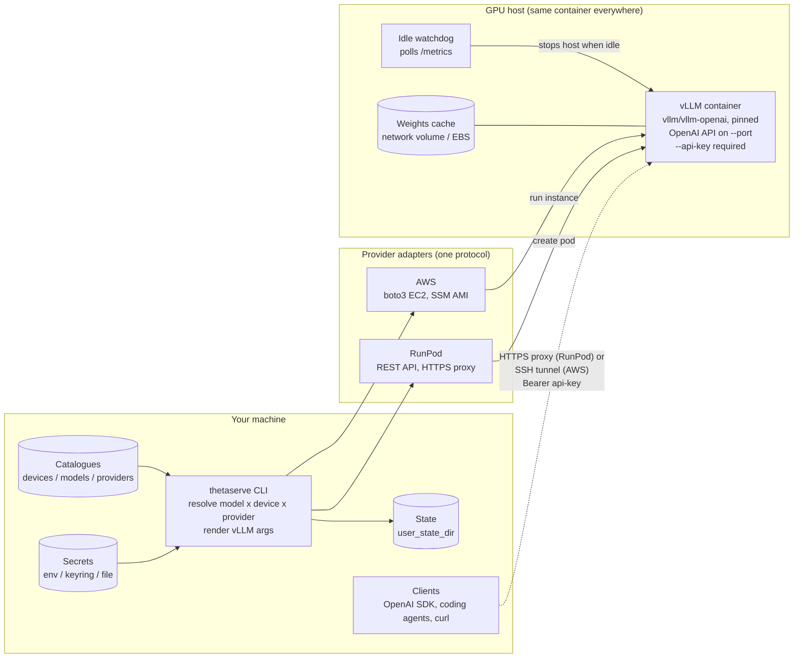
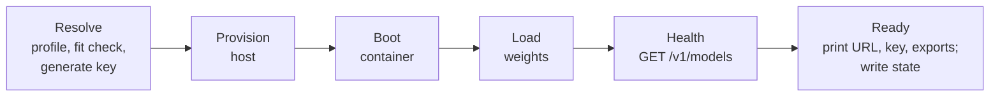

# thetaserve: design brief v0.2

Status: ready to build. Date: 2026-10-20. Supersedes the v0.1 draft (PDF, not kept in the repo); everything still relevant from it is merged here.

## 1. What it is

An open-source CLI, published on PyPI, that launches an open-weight model on a rented GPU and gives you a secured, OpenAI-compatible endpoint. You choose three things independently: **provider**, **device** (GPU class) and **model**. The core asset is the library of tested **profiles**: the settings that make a given model run well on a given GPU tier.

Initial models: Qwen3.8-27B and Gemma 4 31B (both dense, Apache 2.0). Initial providers: RunPod (core) and AWS (extra). Engine: vLLM only.

Non-goals for v0.1:
- Multi-user production serving, autoscaling or load balancing.
- Fine-tuning or training.
- Other engines and providers (see section 16).

## 2. Decisions (final for v0.1 release)

| Topic | Decision |
| --- | --- |
| Provider layer | Custom adapters behind one `Provider` protocol. RunPod in core, AWS as the `aws` extra. SkyPilot is NOT a dependency; a SkyPilot adapter may come later as an optional `skypilot` extra. |
| Language / tooling | Python 3.13+, uv, hatchling build backend |
| Platforms | Linux, macOS and Windows, including headless Linux (SSH, WSL, containers, CI). CI runs tests on all three |
| Libraries | typer + rich (CLI), pydantic v2 (config models), pyyaml, httpx (RunPod + health checks), keyring (OS secret store), platformdirs (per-OS config/state paths) |
| Extras | `aws` -> boto3. Dev tools (pytest, respx, moto, ruff, mypy) are a `dev` dependency group, not a published extra. Each dependency is added in the milestone that first uses it |
| License | Apache-2.0 |
| Release | GitHub Actions + PyPI trusted publishing (no stored tokens). Claim the `thetaserve` name on PyPI early. |
| Runtime | Official `vllm/vllm-openai` image, pinned to one version per profile set |
| Access | RunPod: provider HTTPS proxy URL + per-launch API key. AWS: SSH tunnel; no public model port |
| Not used | Terraform, Knative/KServe (KServe only for a later shared team gateway) |

## 3. Packaging

```
pip install thetaserve            # core + RunPod
pip install "thetaserve[aws]"     # + AWS (boto3)
```
Entry point: `thetaserve = "thetaserve.cli:app"`. Built-in catalogues (devices, models, providers YAML) ship inside the package as package data; users can override or extend them with files in the user config directory (`platformdirs.user_config_dir("thetaserve")`, e.g. `~/.config/thetaserve/` on Linux; later entries win, merged by key).

## 4. Components

No always-on control plane: the CLI on your machine calls the provider API directly, launches one GPU host running the vLLM container, waits until the model answers, and records the deployment in local state. Solid arrows are control calls; dotted arrows are inference traffic.



| Component | Responsibility |
| --- | --- |
| CLI (`cli.py`) | Commands, progress output, error messages |
| Config (`config.py`) | Pydantic models for the three catalogues; load + merge built-in and user files; validation errors with file and key |
| Resolver (`profiles.py`) | model x device -> concrete `LaunchSpec` (image, vLLM args, env, port, disk); memory-fit check |
| Providers (`providers/`) | `base.py` protocol + dataclasses, `runpod.py`, `aws.py` |
| Remote scripts (`remote/`) | `start.sh` (starts vLLM + watchdog), `watchdog.py`, `aws_user_data.sh` template |
| Health (`health.py`) | Poll `/v1/models`; parse the KV-cache size vLLM logs at start-up; report real max context |
| State (`state.py`) | `state.json` in `platformdirs.user_state_dir("thetaserve")` (mode 600 on POSIX): deployments, endpoints, start time, rate. Secrets NOT stored here |
| Secrets (`secrets.py`) | Per-launch vLLM key generation. Lookup order, first hit wins: (1) environment variable (`RUNPOD_API_KEY`, `HF_TOKEN`, ...); (2) keyring, only if a real backend is available (the `fail` and `null` backends count as unavailable); (3) `secrets.json` in the user config directory, mode 600 on POSIX, with a one-time warning that it is plaintext. Writes go to keyring when available, otherwise to the file |
| Bench (`bench.py`) | Benchmark harness (section 10) |

## 5. Configuration

### 5.1 devices.yaml
> Superseded by [ADR 0001](adr/0001-derive-launch-options.md): `up` without `--device` derives options from live data. Sections 5.1, the tiers in 5.2, and rules 1-2 of section 6 apply only to pinned launches until they are removed.

```yaml
a6000-48g:
  vram_gb: 48
  arch: ampere          # no native FP8
  providers:
    runpod: { gpu_type_id: "NVIDIA RTX A6000" }
rtx6000ada-48g:
  vram_gb: 48
  arch: ada
  providers:
    runpod: { gpu_type_id: "NVIDIA RTX 6000 Ada Generation" }
l40s-48g:
  vram_gb: 48
  arch: ada
  providers:
    runpod: { gpu_type_id: "NVIDIA L40S" }
    aws:    { instance_type: g6e.xlarge }
rtx4090-24g:
  vram_gb: 24
  arch: ada
  providers:
    runpod: { gpu_type_id: "NVIDIA GeForce RTX 4090" }
a100-80g:
  vram_gb: 80
  arch: ampere
  providers:
    runpod: { gpu_type_id: "NVIDIA A100 80GB PCIe" }
h100-80g:
  vram_gb: 80
  arch: hopper
  providers:
    runpod: { gpu_type_id: "NVIDIA H100 80GB HBM3" }
```
RunPod GPU type IDs above are from RunPod's GPU types reference. `arch` values: ampere, ada, hopper, blackwell.

### 5.2 models.yaml
Profiles are keyed by memory tier, with optional per-architecture overrides. All memory sizes (`vram_gb`, `weights_gb`) are GiB; KV constants are bytes at BF16 and are halved for FP8 KV. `vllm_image` pins the image for the whole profile set. The block below is abridged; the catalogue in `src/thetaserve/catalog/` also carries `weights_gb` per tier and `kv_bytes_per_token` / `kv_fixed_bytes` per model.
```yaml
schema_version: 1
vllm_image: vllm/vllm-openai:TODO-pin
qwen3.8-27b:
  hf_family: Qwen/Qwen3.8-27B
  min_vllm: "0.17"
  common_args: [--enable-prefix-caching, --reasoning-parser, qwen3,
                --enable-auto-tool-choice, --tool-call-parser, qwen3_xml]   # VERIFY in pilot
  tiers:
    24g: { repo: TODO-4bit-AWQ-or-GPTQ, max_model_len: 65536, kv_cache_dtype: fp8,
           extra_args: [--limit-mm-per-prompt, '{"image":0}'] }          # VERIFY flag syntax
    48g: { repo: TODO-FP8, max_model_len: 131072, kv_cache_dtype: auto }
    80g: { repo: TODO-FP8-or-BF16, max_model_len: 262144, kv_cache_dtype: auto }
gemma4-31b:
  hf_family: google/gemma-4-31B-it   # verified 2026-10-21; quantisations are made from this
  min_vllm: TODO
  common_args: [--enable-prefix-caching, --reasoning-parser, gemma4,
                --enable-auto-tool-choice, --tool-call-parser, gemma4]   # VERIFY in pilot
  tiers:
    24g: { repo: TODO-4bit, max_model_len: 32768, kv_cache_dtype: fp8 }
    48g:
      repo: TODO-FP8
      max_model_len: 131072
      kv_cache_dtype: fp8
      arch_overrides:
        ampere: { kv_cache_dtype: auto }   # FP8 KV on Ampere unverified; BF16 KV fits (~31 GB weights + ~11 GB KV)
    80g: { repo: TODO-FP8, max_model_len: 262144, kv_cache_dtype: fp8 }
    # NOTE: BF16 weights (~62 GB) + BF16 KV at 256K (~21 GB) do NOT fit in 80 GB; the v0.1 draft was wrong here.
```
Every `TODO` is filled during the pilot with a tested value. A profile gains a `tested:` block when verified:
```yaml
tested: { vllm: "0.17.x", date: 2026-11-05, devices: [a6000-48g], results: results/qwen3.8-27b/a6000-48g-2026-11-05.json }
```

### 5.3 providers.yaml
```yaml
runpod:
  api_key_env: RUNPOD_API_KEY      # else keyring entry "thetaserve/runpod", else secrets file
  cloud_type: SECURE               # or COMMUNITY
  network_volume: thetaserve-cache # created on first use, per data centre
  container_disk_gb: 40
aws:
  profile: thetaserve              # dedicated IAM user, minimal EC2 policy
  region: us-east-1
  ami_ssm: /aws/service/deeplearning/ami/x86_64/base-oss-nvidia-driver-gpu-ubuntu-22.04/latest/ami-id
  root_volume_gb: 200
  ssh_key_name: thetaserve
  allow_cidr: auto                 # caller's public IP /32
```

## 6. Resolution rules
> Rules 1-2 apply only with `--device`; see [ADR 0001](adr/0001-derive-launch-options.md).


1. Tier = the largest tier whose size is <= the device's `vram_gb`. No tier fits -> error naming the smallest tier.
2. Apply `arch_overrides[device.arch]` if present.
3. Apply CLI flags (`--context`, `--kv-cache-dtype`, `--extra-arg`), highest precedence.
4. Fit check: estimated weights + KV(max_model_len) + overhead (default 2 GB) <= vram_gb x gpu_memory_utilization (default 0.92). KV estimate uses per-model constants in the profile (`kv_bytes_per_token`, `kv_fixed_bytes`). Fail with the numbers unless `--force`.
5. Render the vLLM command: `vllm serve <repo> --port <port> --api-key $VLLM_API_KEY --max-model-len N --kv-cache-dtype D --gpu-memory-utilization U <common_args> <extra_args>`.

Memory constants for the two launch models (per sequence):

| Model | KV per token (BF16) | Fixed KV | 128K KV BF16 / FP8 |
| --- | --- | --- | --- |
| Qwen3.8-27B | 64 KB (16 of 64 layers full attention, 4 KV heads, head dim 256) | small linear-attention state | 8.0 / 4.0 GB |
| Gemma 4 31B | ~80 KB (10 global layers, 4 KV heads, head dim 512) | ~0.8 GB (50 sliding layers, window 1024) | 10.8 / 5.4 GB |

Ampere vs Ada: the A6000 (Ampere) has no native FP8; vLLM runs FP8 weights with weight-only kernels. Token generation is similar to Ada cards (memory-bandwidth bound), but prefill of a long prompt is roughly 2-3x slower. Prefix caching hides most of this for coding agents, whose prompts repeat between steps.

## 7. CLI

```
thetaserve setup                       # check/collect provider credentials, HF token, SSH key
thetaserve up --provider runpod --device a6000-48g --model qwen3.8-27b --port 8000
             [--context N] [--idle 30m] [--max-life 10h] [--name dev] [--dry-run] [--force]
thetaserve status [name]               # endpoint, model, uptime, cost so far, idle time
thetaserve env [name]                  # OPENAI_BASE_URL / OPENAI_API_KEY exports
thetaserve tunnel [name]               # AWS only
thetaserve logs [name] [-f]
thetaserve stop | start | down [name] [--purge]
thetaserve list models|devices|providers
thetaserve bench --provider ... --device ... --model ... [--out results/]
```
`--dry-run` prints the resolved LaunchSpec, the vLLM command and the provider request body, with secrets masked, and creates nothing. It must work with no credentials configured.

`up` lifecycle:



Before provisioning it prints the hourly rate. It streams progress and fails early with a clear message if a step stalls. Expected time: 5-15 min on first start (image pull + ~30 GB weights), 2-5 min on a warm restart from the cached volume.

## 8. Providers

```python
class Provider(Protocol):
    name: str

    def plan(
        self, spec: LaunchSpec
    ) -> dict[str, Any]: ...  # request body, secrets masked; no network
    def create(self, spec: LaunchSpec, secrets: Mapping[str, str]) -> Deployment: ...
    def wait_running(self, d: Deployment, timeout_s: int) -> Deployment: ...
    def refresh(self, d: Deployment) -> Deployment: ...  # current status and cost
    def endpoint(self, d: Deployment) -> Endpoint: ...  # base_url, needs_tunnel
    def logs(self, d: Deployment, follow: bool, tail: int = 100) -> Iterator[str]: ...
    def stop(self, d: Deployment) -> Deployment: ...
    def start(self, d: Deployment) -> Deployment: ...
    def destroy(self, d: Deployment, purge: bool = False) -> None: ...
    def price_per_hour(self, spec: LaunchSpec) -> float | None: ...
```
Secrets are passed to `create` separately so `LaunchSpec` and the state file never hold them. The per-launch vLLM key is stored in the secrets store as `deployment/<name>/api-key` before the host is created, and deleted by `down`.

### 8.1 RunPod (core)
- API: Runpod REST API v2, `https://api.runpod.io/v2`, Bearer auth; the spec is at `https://api.runpod.io/v2/openapi.json`. v1 (`rest.runpod.io/v1`) is legacy. Checked 2026-10-20; re-check against the spec when changing the adapter.
- Calls: `POST /v2/pods` (create), `GET /v2/pods/{id}` (status, `cost` in USD/h), `POST /v2/pods/{id}/action` with `start`/`stop` (`409` if invalid for the current status), `DELETE /v2/pods/{id}`, `GET /v2/pods/{id}/logs` (Server-Sent Events, `data: {"line": ...}`), `GET|POST /v2/network-volumes`, `GET /v2/catalog/gpus/{id}?include=AVAILABILITY&product=POD` (price and per-data-centre stock). `429` is retried after `Retry-After`.
- Create body: `gpu {id, count}`, `image`, `entrypoint ["/bin/bash","-c"]` + `cmd ["exec vllm serve ..."]` so `$VLLM_API_KEY` expands from the pod's env, `env`, `ports ["<port>/http"]`, `disk`, `cloud`, `mounts.network [{volumeId, path}]`, `dataCenterIds [<volume's data centre>]`. Create does not search for capacity or fall back to another GPU.
- Endpoint: `https://<podId>-<port>.proxy.runpod.net/v1`. The proxy runs through Cloudflare with a 100 s timeout (`524`), so clients must stream long generations.
- Weights cache: network volume mounted at `/runpod-volume`, with `HF_HOME` on it; volumes are per data centre, so place the pod where the volume is. On first use the volume is created in the data centre with the most stock for the GPU. If the GPU is sold out there, try the model's ordered fallback device list, then offer a volume in another data centre.
- Resume: the same GPU type may be unavailable when a stopped pod restarts; the CLI then offers a fresh pod on the same volume.
- Idle stop: the pod must stop itself. If vLLM exits, RunPod restarts the container, so exiting is not enough. **Open question:** does a pod receive a credential that can stop itself? If not, pass a separate limited API key as a secret.

### 8.2 AWS (`aws` extra)
- AMI from the public SSM parameter in `providers.yaml`.
- RunInstances with the device's instance type, gp3 root volume, `InstanceInitiatedShutdownBehavior=stop`, user-data that installs a systemd unit running the vLLM container plus the watchdog.
- Security group: SSH (22) from the caller's /32 only. `thetaserve tunnel` = `ssh -N -L PORT:localhost:PORT`.
- Idle stop: watchdog runs `shutdown -h now`; disk survives.
- Prerequisites detected and explained by `setup`: credentials, GPU quota (G and VT instances), key pair.
- Later option: SSH via AWS Systems Manager so no port is open at all.

Why the access models differ: RunPod already fronts each pod port with HTTPS, so an API key is enough. On AWS an open port would need TLS and certificate management; an SSH tunnel gives encryption and IP restriction for free and keeps the instance invisible to the internet.

## 9. Security
- New 32-byte API key per launch; stored via the secrets store (section 4), never in the state file or logs; masked in all output.
- Secrets reach the host only as environment variables of the server process.
- vLLM's `--api-key` may not protect `/metrics`; on RunPod either block it or accept that request counts are public. Decide in the pilot.
- AWS: dedicated IAM user with a minimal policy: EC2 run/describe/stop/terminate, security groups, key pairs, and the SSM AMI parameter.
- Client data: prompts are processed on rented hardware. For client work that needs stronger guarantees, use RunPod Secure Cloud or AWS, not Community Cloud.

## 10. Benchmark harness (`thetaserve bench`)
Launches a profile, runs a fixed workload against the endpoint, writes one JSON result, then tears down (unless `--keep`).
Measures: tokens/sec at 1 and 4 concurrent requests; time to first token at 8K, 32K and 128K prompt lengths (capped at the profile's context); real KV-cache capacity from vLLM's start-up log; time to ready (cold and warm); $/hr and $/million output tokens; a small fixed coding-quality check so 4-bit vs 8-bit can be compared.
Result file: `results/<model>/<device>-<provider>-<date>.json` with profile hash, vLLM version, image digest, hardware, all metrics. Results are committed so anyone can reproduce and compare.

## 11. Repository layout
```
thetaserve/
  pyproject.toml  uv.lock  justfile  README.md  LICENSE  CHANGELOG.md  CLAUDE.md
  src/thetaserve/
    __init__.py  cli.py  config.py  profiles.py  state.py  secrets.py  health.py  bench.py
    providers/  base.py  runpod.py  aws.py
    remote/     start.sh  watchdog.py  aws_user_data.sh
    catalog/    devices.yaml  models.yaml  providers.yaml
  results/
  tests/        test_config.py  test_profiles.py  test_render.py  test_runpod.py (respx)  test_aws.py (moto)
  docs/DESIGN.md
  .github/workflows/  ci.yml  release.yml
```

## 12. Build order

| Milestone | Scope | Done when |
| --- | --- | --- |
| M0 | Scaffold, pyproject with extras, config models, catalogues, resolver, fit check, `list`, `up --dry-run`, tests, CI | `uv run thetaserve up ... --dry-run` prints a correct vLLM command for every model x device |
| M1 | RunPod adapter, secrets, state, health, `up/status/env/logs/stop/down` | Qwen3.8-27B runs on a RunPod A6000 and a coding agent connects |
| M2 | Pilot: fill every TODO in models.yaml from real runs; resolve open questions in section 13 | All launch profiles have a `tested:` block |
| M3 | Watchdog (idle + max lifetime) on RunPod | An idle pod stops itself |
| M4 | `bench` + first results | Results for 2 models x 3 GPUs committed; published post (target 2026-11-09) |
| M5 | AWS adapter + tunnel | Same model on g6e.xlarge via tunnel |
| M6 | v0.1 release on PyPI (target 2026-12-07) | `pip install thetaserve` works from a clean machine |

## 13. Open questions (resolve in M1/M2)
- ~~Runpod REST API exact fields; proxy URL format; request timeout on the proxy.~~ Resolved in M1 (section 8.1). Still to confirm on real hardware: that streamed responses survive past the proxy's 100 s timeout.
- RunPod pod self-stop credential (section 8.1).
- Exact FP8 and 4-bit repositories for both models; their quality.
- vLLM version supporting both models; flags for disabling image input; Qwen reasoning and tool parsers; Gemma tool parser.
- FP8 KV cache on Ampere (A6000) in the pinned vLLM.
- Whether `/metrics` is protected by `--api-key`.
- Whether a Hugging Face token is needed for either model.

## 14. Rules for contributors (and agents)
- Tests never call real provider APIs; mock with respx (httpx) and moto (boto3).
- Never print or log a secret; persist secrets only to keyring or the mode-600 secrets file, never the state file.
- No hard-coded POSIX paths; resolve config and state locations with platformdirs.
- Every number in a profile comes from a recorded run; no guessed values without a `TODO`.
- Keep core dependencies to the list in section 2.

## 15. Cost controls

| Control | How it works |
| --- | --- |
| Idle shutdown | Watchdog reads vLLM's Prometheus `/metrics` every minute; if the completed-request counter has not moved and nothing is running for `--idle` (default 30 min), it stops the host (sections 8.1, 8.2) |
| Maximum lifetime | Hard stop after `--max-life` (default 10 h) regardless of activity |
| Stop vs down | `stop` pauses compute and keeps weights (pay for disk only); `down` removes compute; the cache volume survives unless `--purge` |
| Visibility | `up` prints the hourly rate before creating anything; `status` shows rate, uptime and cost so far |
| Budget alarm | Recommended, set once by hand: an AWS Budgets alert and a RunPod spend limit |

Indicative RunPod Secure Cloud prices (seen 2026-10; the CLI reads live prices where the provider exposes them):

| Device | $/hr | 2 h/day x 30 days | 8 h/day x 22 days |
| --- | --- | --- | --- |
| RTX A6000 48 GB | 0.59 | $35 | $104 |
| RTX 6000 Ada 48 GB | 0.99 | $59 | $174 |
| L40S 48 GB | 1.09 | $65 | $192 |

## 16. Roadmap after v0.1

| Phase | Scope | Done when |
| --- | --- | --- |
| Next | More providers (Vast.ai), engines (SGLang, Ollama for CPU/Mac), several models per host | Provider and engine chosen by flag |
| Later | Shared team endpoint: gateway with per-user keys and usage metering (KServe candidate, section 2) | ThetaPlex products and client pilots use a shared inference service |
